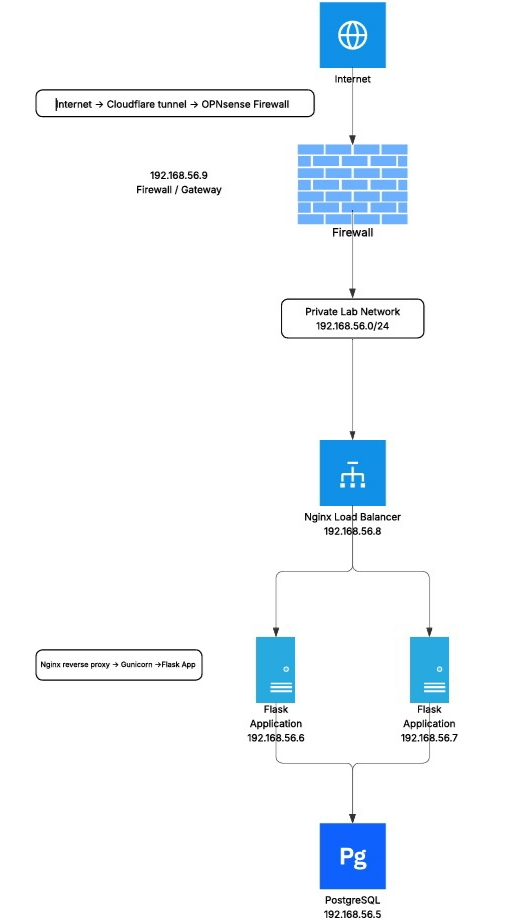
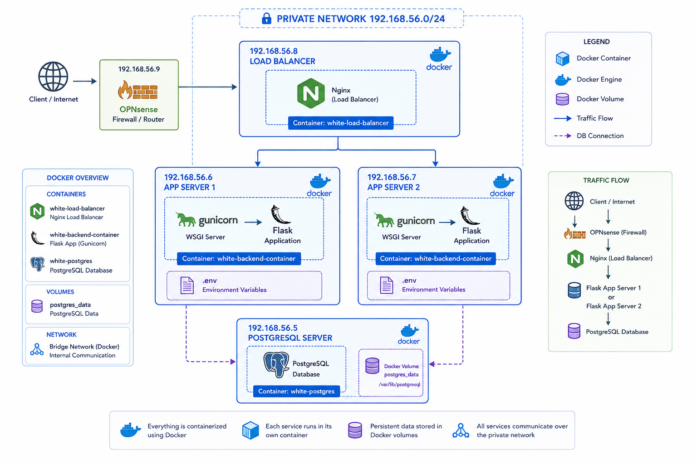
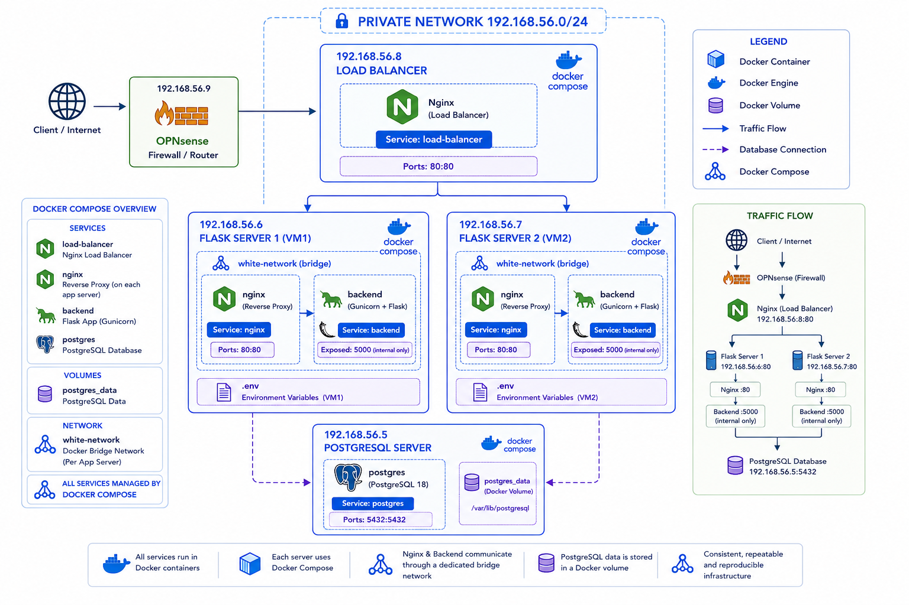
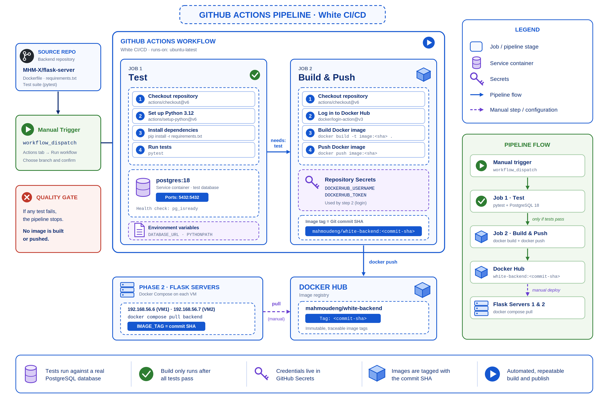

# Self-Hosted API Infrastructure

### A production-style backend environment, built from the network up in three phases

## 📖 About

This project hosts the backend of my **White** application on infrastructure that I designed, built, and automated myself.

The backend was migrated from a Backend-as-a-Service architecture to a manually managed stack, with one goal: **to understand what happens underneath managed platforms.**

The project is built in three phases, and each phase builds on the previous one:

## 🗺️ Phases

<table>
  <tr>
    <td width="55%" align="center">
      
    </td>
    <td width="45%" valign="top">
      <h3>Phase 1 · Infrastructure</h3>
      
A private network where <b>OPNsense</b> acts as the firewall, gateway, and DNS resolver. An <b>Nginx load balancer</b> distributes traffic between two <b>Flask + Gunicorn</b> application servers, backed by a dedicated <b>PostgreSQL</b> server. External access is provided through <b>Cloudflare Tunnel</b>.

      

        <code>OPNsense</code> · <code>Nginx</code> · <code>Flask</code> · <code>Gunicorn</code> · <code>PostgreSQL</code> · <code>Cloudflare Tunnel</code>
      

      <a href="./phase-1.md"><b>Read Phase 1 →</b></a>
    </td>
  </tr>

  <tr>
    <td width="45%" valign="top">
      <h3>Phase 2 · Docker</h3>
      
Every service was containerized. First with plain <code>docker run</code>, then with <b>Docker Compose</b>. Each Flask server now runs an <b>internal Nginx reverse proxy</b> in front of the backend, connected through a dedicated Docker bridge network, with persistent volumes for the database.

      

        <code>Docker</code> · <code>Docker Compose</code> · <code>Docker Networks</code> · <code>Volumes</code> · <code>Docker Hub</code>
      

      <a href="./phase-2.md"><b>Read Phase 2 →</b></a>
    </td>
    <td width="55%" align="center">
      
        
      
    </td>
  </tr>

  <tr>
    <td width="55%" align="center">
      
    </td>
    <td width="45%" valign="top">
      <h3>Phase 3 · CI/CD Pipeline</h3>
      
A <b>GitHub Actions</b> pipeline that runs the test suite against a real PostgreSQL service container, then builds the Docker image and pushes it to <b>Docker Hub</b>, tagged with the Git commit SHA for full traceability.

      

        <code>GitHub Actions</code> · <code>pytest</code> · <code>Docker Hub</code> · <code>Secrets</code>
      

      <a href="./phase-3.md"><b>Read Phase 3 →</b></a>
    </td>
  </tr>
</table>
